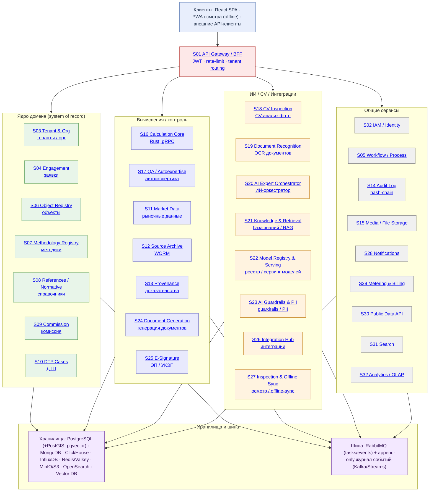

# Предварительная оценка backend-стека

Версия: v.0.1

---

## Оглавление

- [1. Резюме](#1-резюме)
  - [1.1 Зафиксированные решения](#11-зафиксированные-решения-после-ответов-заказчика)
- [2. Что делает система (домен)](#2-что-делает-система-домен)
  - [2.1 Три режима работы](#21-три-режима-работы)
  - [2.2 Шесть направлений (типов объектов)](#22-шесть-направлений-типов-объектов)
  - [2.3 Восемь шагов процесса](#23-восемь-шагов-процесса)
  - [2.4 Функциональные блоки (по прототипу)](#24-функциональные-блоки-по-прототипу)
  - [2.5 Официально заявленный стек (лендинг)](#25-официально-заявленный-стек-лендинг)
- [3. Архитектурные принципы → ограничения на стек](#3-архитектурные-принципы--ограничения-на-стек)
- [4. Целевая топология (обзор)](#4-целевая-топология-обзор)
- [5. Каталог микросервисов](#5-каталог-микросервисов)
  - [5.1 Периметр и доступ](#51-периметр-и-доступ)
  - [5.2 Ядро домена (system of record)](#52-ядро-домена-system-of-record)
  - [5.3 Данные, доказательства, архивы](#53-данные-доказательства-архивы)
  - [5.4 Расчёт и контроль качества](#54-расчёт-и-контроль-качества)
  - [5.5 ИИ и компьютерное зрение](#55-ии-и-компьютерное-зрение)
  - [5.6 Документы, подпись](#56-документы-подпись)
  - [5.7 Динамика, коммуникации, данные наружу](#57-динамика-коммуникации-данные-наружу)
- [6. Слой данных (полиглот-персистентность)](#6-слой-данных-полиглотперсистентность)
- [7. Асинхронность и брокер](#7-асинхронность-и-брокер)
  - [7.1 Базовый вариант](#71-базовый-вариант-по-наброску)
  - [7.2 Что нужно добавить](#72-что-нужно-добавить)
- [8. Расчётное ядро (Rust) — критический компонент](#8-расчётное-ядро-rust--критический-компонент)
- [9. ИИ и компьютерное зрение](#9-ии-и-компьютерное-зрение)
  - [9.1 Состав](#91-состав)
  - [9.2 Guardrails (обязательны, отдельный сервис S23)](#92-guardrails-обязательны-отдельный-сервис-s23)
  - [9.3 Разделение контуров](#93-разделение-контуров)
- [10. Интеграции](#10-интеграции)
- [11. Воспроизводимость и доказуемость (provenance)](#11-воспроизводимость-и-доказуемость-provenance)
- [12. Безопасность и соответствие](#12-безопасность-и-соответствие)
- [13. Наблюдаемость и эксплуатация](#13-наблюдаемость-и-эксплуатация)
- [14. Расширения и корректировки к исходному наброску](#14-расширения-и-корректировки-к-исходному-наброску)
  - [14.1 Вердикт по каждому пункту наброска](#141-вердикт-по-каждому-пункту-наброска)
  - [14.2 Что добавлено и почему](#142-что-добавлено-и-почему)
  - [14.3 Лицензионные и импортные риски (важно)](#143-лицензионные-и-импортные-риски-важно)
  - [14.4 MVP на привычном стеке → замены из реестра росПО (плановая миграция)](#144-mvp-на-привычном-стеке--замены-из-реестра-роспо-плановая-миграция)
  - [14.5 Архитектура под две среды (R4)](#145-архитектура-под-две-среды-r4)
  - [14.6 Граница ядра домена (R3)](#146-граница-ядра-домена-r3)
- [15. Нефункциональные требования](#15-нефункциональные-требования-черновые-требуют-уточнения)
  - [15.1 Периферия в MVP: mock-объём (R6)](#151-периферия-в-mvp-mockобъём-r6)
  - [15.2 Учли «и то, и другое» для моделей (R1)](#152-учли-и-то-и-другое-для-моделей-r1)
- [16. Вопросы: статус](#16-вопросы-статус)
  - [16.1 Закрыто](#161-закрыто)
  - [16.2 Остаётся уточнить](#162-остаётся-уточнить)
- [17. Следующие шаги](#17-следующие-шаги)

---

## 1. Резюме

Платформа доказательной оценки. Ключевая ценность не в расчётах как таковых, а в
доказуемости каждого числа: источник с архивной копией и хешем, версия методики, детерминированный
пересчёт, решение и подпись человека, неизменяемый журнал.

Из этого следует главный вывод для выбора стека:

> Стек должен обслуживать в первую очередь воспроизводимость, трассируемость и неизменяемость,
> и только во вторую — удобство микросервисного дробления.

Итоговая модель: строгое ядро домена на PostgreSQL (транзакции, RLS, PostGIS) + расчётное ядро
на Rust (детерминизм, точная десятичная арифметика) + документоориентированные хранилища для
гибких структур и артефактов + event-driven обмен через RabbitMQ + отдельный неизменяемый контур
доказательств (WORM-хранилище, провенанс, аудит).

### 1.1 Зафиксированные решения
| № | Вопрос | Решение |
|---|---|---|
| R1 | «Python для моделей» | И ML/AI-модели, и оценочные модели — нужны оба контура ([S22](#s22) + [S07](#s07)/[S16](#s16)) |
| R2 | Импортонезависимость | Приоритет — MVP на привычном стеке. Замены и аналоги из реестра росПО фиксируются заранее (раздел 14.4), чтобы миграция была плановой, а не аварийной |
| R3 | Граница микросервисов | Ядро домена — 3–4 сервиса на общей PostgreSQL (схемы + RLS), остальное независимо |
| R4 | Среда развёртывания | Два равноправных варианта: облако РФ и контур заказчика; архитектура должна разворачиваться в обоих |
| R5 | Расчётное ядро Rust | Отдельный сервис на gRPC (не встраиваемая библиотека) |
| R6 | Периферия в MVP | Всё проектируется; в MVP — имитации (таблица Mock-объёма, раздел 15.1) |

[↑ К оглавлению](#оглавление)

---

## 2. Что делает система (домен)

Ниже — сжатая модель домена, собранная из описания и прототипа. Она определяет состав сервисов.

### 2.1 Три режима работы
| Режим | Исполнитель | Результат | Особенности |
|---|---|---|---|
| Комиссия | Внутренняя оценочная комиссия | Заключение + протокол голосования | Кворум, особое мнение, самоотвод |
| Отчёт 135-ФЗ | Оценщик — член СРО с аттестатом | Отчёт по ФСО VI с УКЭП | Задание по ФСО IV, автоэкспертиза, проверка независимости |
| Экспертиза ТС | Эксперт-техник из госреестра | Заключение, калькуляция, акт, фототаблица | Методика по цели: ОСАГО / Минюст / КАСКО |

### 2.2 Шесть направлений (типов объектов)
Недвижимость (ФСО № 7), Строительство (ФСО № 7 + 421/пр), Машины и оборудование (ФСО № 10),
Транспорт и ущерб ТС (ФСО № 10 + Единая методика), ИС (ФСО № 11), ПО (ФСО № 11 + ГК РФ ч. 4).
Каталог: 39 методов. У каждого направления свой тип карточки, источники данных и шаблоны.

### 2.3 Восемь шагов процесса
Заявка → Задание на оценку → Осмотр → Рыночные данные → Расчёт → Согласование → Проверка →
Выпуск. Возвраты на расчёт при замечаниях. Каждый переход — в журнал.

### 2.4 Функциональные блоки (по прототипу)
- Реестр заявок и объектов (объект живёт независимо от заявок).
- Библиотека методик: пакеты с версиями, входами, формулами, проверками, эталонными тестами.
- Расчётное ядро: ME-K1, ME-C1, IP-I1 и др.; промежуточные значения; торнадо-чувствительность; согласование подходов.
- Рыночные данные: аналоги, сделки, ставки роялти, индексы, сметные цены; архивная копия и хеш каждого источника.
- Автоэкспертиза: каталог 36 правил (Блокирующее / Существенное / Рекомендация) + рецензент (человек или ИИ в отдельном контексте).
- Модуль ДТП: фотопротокол, анализ повреждений, калькуляция по сценариям, УТС, полная гибель, антифрод (7 сигналов).
- ИИ-эксперт: 9 агентов (приёмщик, исследователь рынка, методолог, расчётчик, автор, рецензент, юрист, фотоаналитик, консультант), уровни L1–L4, вызовы инструментов, ссылки на нормы.
- Комиссия: заседания, повестка, голосование, кворум, протокол.
- Документы: отчёты/заключения/протоколы/акты/фототаблицы, версии, подписи, QR-проверка подлинности, экспорт DOCX/PDF-A/XLSX/XML.
- Анализ по фото: недвижимость, стройка (процент готовности), оборудование (шильдики), документы, подлинность.
- Выездной осмотр: PWA, чек-лист, контроль качества кадра на устройстве, геометка, работа без связи.
- Интеграции: ЕГРН, НСПД, ФИПС, ФГИС ЦС, ЦБ, Росстат, РСА, каталоги запчастей, сборщики объявлений, 1С, Git, КриптоПро, ЕСИА.
- Специалисты: аттестаты, СРО, страхование, сроки.
- Аналитика: сроки, загрузка, типы замечаний, доля принятых подсказок ИИ.
- Администрирование: пользователи, роли/права, интеграции, настройки организации, журнал аудита (цепочка хешей).

[↑ К оглавлению](#оглавление)

---

## 3. Архитектурные принципы → ограничения на стек

Четыре правила платформы — это не пожелания, а прямые технические требования:

| Правило платформы | Техническое следствие для стека |
|---|---|
| Расчёт воспроизводим до копейки | Точная десятичная арифметика (не float); версионирование методик; пиннинг версий; фиксация входов; детерминированный движок; регрессионные тесты на эталонах |
| Каждый источник сохранён | WORM-хранилище (Object Lock), снимок страницы + дата + хеш, запрет источников позже даты оценки |
| ИИ не определяет стоимость | Числа только из расчётного ядра или из источника; агент вызывает инструменты; жёсткая валидация вывода |
| Решает и подписывает человек | Human-in-the-loop; разделение ИИ-предложений и подтверждений; неизменяемый журнал с автором |

Дополнительные ограничения:
- Регуляторика РФ: 152-ФЗ (ПДн, хранение в РФ), приказ ФСТЭК № 21, УКЭП, ГОСТ-TLS для госзаказчиков.
- Импортонезависимость: AlmaLinux OS 10, Postgres Pro, подготовка к реестру российского ПО.
- Изоляция организаций: разделение на уровне строк БД + собственные ключи шифрования.
- Неизменяемость: цепочка хешей журнала; документы ≥ 3 лет в неизменяемом хранилище.
- Доступность: RPO ≤ 15 минут, RTO ≤ 4 часа.

[↑ К оглавлению](#оглавление)

---

## 4. Целевая топология (обзор)

Слои по контурам доверия (сверху вниз: клиенты → шлюз → контуры сервисов → данные/шина).
Узлы `Sxx` снабжены ссылками на строки каталога в разделе 5:

>
> - **Контур «Периметр и доступ» (5.1):** [S01](#s01) · [S02](#s02) · [S03](#s03)
> - **Контур «Ядро домена» (5.2):** [S04](#s04) · [S05](#s05) · [S06](#s06) · [S07](#s07) · [S08](#s08) · [S09](#s09) · [S10](#s10)
> - **Контур «Данные, доказательства, архивы» (5.3):** [S11](#s11) · [S12](#s12) · [S13](#s13) · [S14](#s14) · [S15](#s15)
> - **Контур «Расчёт и контроль качества» (5.4):** [S16](#s16) · [S17](#s17)
> - **Контур «ИИ и компьютерное зрение» (5.5):** [S18](#s18) · [S19](#s19) · [S20](#s20) · [S21](#s21) · [S22](#s22) · [S23](#s23)
> - **Контур «Документы, подпись» (5.6):** [S24](#s24) · [S25](#s25)
> - **Контур «Динамика, коммуникации, наружу» (5.7):** [S26](#s26) · [S27](#s27) · [S28](#s28) · [S29](#s29) · [S30](#s30) · [S31](#s31) · [S32](#s32)

[↑ К оглавлению](#оглавление)

---

## 5. Каталог микросервисов

Принцип дробления: сервисом становится то, что имеет (а) собственный жизненный цикл и
масштабирование, (б) собственные данные, (в) изоляцию по отказу/безопасности/лицензии,
(г) внешнюю границу (интеграцию, подпись, ИИ-контур). Домен, требующий распределённых
транзакций, НЕ дробится (см. раздел 15).

### 5.1 Периметр и доступ

| ID | Сервис | Ответственность | Данные | Технология | Почему изолирован |
|---|---|---|---|---|---|
| S01 | API Gateway / BFF | Маршрутизация, аутентификация запросов, rate-limit, агрегация для SPA, tenant-routing, версии API | Нет своих (кэш) | FastAPI/NGINX/Kong/Traefik | Единая точка входа, защита внутренних сервисов, отдельный контур для Public API |
| S02 | IAM / Identity | Пользователи, роли, матрица прав, MFA, SSO (OIDC/SAML), ЕСИА, выдача и отзыв JWT | PostgreSQL + Redis | FastAPI + Keycloak (или аналог) | Безопасность и SSO — отдельный контур; критичен для всех |
| S03 | Tenant & Org | Организации, настройки (кворум, шаблоны, сроки хранения), ключи шифрования, политики RLS | PostgreSQL | FastAPI + KMS/Vault | Мультитенантность, изоляция, ключи — отдельный домен безопасности |

[↑ К оглавлению](#оглавление)

### 5.2 Ядро домена (system of record)

| ID | Сервис | Ответственность | Данные | Технология | Почему изолирован |
|---|---|---|---|---|---|
| S04 | Engagement (Заявки) | Жизненный цикл заявки, статусы, назначение исполнителя, проверка квалификации/независимости, сроки, SLA | PostgreSQL | FastAPI | Центральный домен, транзакции, «сердце» процесса |
| S05 | Workflow / Process | Оркестрация 8 шагов, возвраты, эскалации, дедлайны, задачи «требует действия» | PostgreSQL | FastAPI + Camunda/Temporal (open) | Долгие процессы, повторы, компенсации — отдельная логика и отказоустойчивость |
| S06 | Object Registry | Реестр объектов, схемы характеристик по направлениям, вложенные объекты (комплексы), права/обременения, история оценок, поиск дублей | PostgreSQL (+Mongo для гибких характеристик) | FastAPI | Объект живёт независимо от заявок; отдельные схемы |
| S07 | Methodology Registry | Пакеты методик, версии, входы, формулы, проверки, эталонные тесты, публикация, выведенные версии | PostgreSQL + объектное хранилище | FastAPI | Версионирование и тесты методик — критичный, изолируемый контур |
| S08 | References / Normative | Нормативы (ФСО), ставки, индексы, шкалы, правила с датами действия; выбор редакции на дату оценки/ДТП | PostgreSQL | FastAPI | Диктует достоверность расчёта; частые обновления по расписанию |
| S09 | Commission | Заседания, повестка, голосование, кворум, самоотвод, особое мнение, протокол | PostgreSQL | FastAPI | Отдельный процесс и роли |
| S10 | DTP Cases (Ущерб ТС) | Дела ДТП, фотопротокол, анализ повреждений, калькуляция по сценариям, УТС, полная гибель, сравнение с выплатой | PostgreSQL + MongoDB | FastAPI (+ Rust-ядро) | Самостоятельный модуль с собственными сценариями и правилами |

[↑ К оглавлению](#оглавление)

### 5.3 Данные, доказательства, архивы

| ID | Сервис | Ответственность | Данные | Технология | Почему изолирован |
|---|---|---|---|---|---|
| S11 | Market Data | Аналоги, сделки, роялти, индексы, сметные цены; качество записи; использование; ручной ввод с подтверждением | PostgreSQL + объектное хранилище | FastAPI + Celery-сборщики | Отдельный домен данных, частые фоновые загрузки |
| S12 | Source Archive (WORM) | Неизменяемые архивные копии источников (страница, HTML, скриншот), хеш SHA-256, срок ≥ 3 лет | S3/MinIO с Object Lock | Сервис-фасад над S3 | Требование доказуемости и сроков; отдельный контур хранения |
| S13 | Provenance / Attestation | Сквозная цепочка «число → источник → версия методики → входы → специалист»; хеши артефактов; воспроизведение | PostgreSQL + ссылки в S3 | FastAPI (+ Rust для хеш-цепочек) | Сердце принципа «каждая цифра с доказательством» |
| S14 | Audit Log | Неизменяемый журнал действий (в т.ч. ИИ), цепочка хешей, проверка целостности | PostgreSQL append-only (или append-only лог + ClickHouse) | FastAPI + hash-chain | Регуляторное требование; не редактируется задним числом |
| S15 | Media / File Storage | Документы, фото, архивы; шифрование при хранении; ключи на тенант | S3/MinIO | Сервис-фасад | Единый слой файлов, WORM, разграничение |

[↑ К оглавлению](#оглавление)

### 5.4 Расчёт и контроль качества

| ID | Сервис | Ответственность | Данные | Технология | Почему изолирован |
|---|---|---|---|---|---|
| S16 | Calculation Core | Детерминированный расчёт по методикам; промежуточные значения; чувствительность; согласование; калькуляция ДТП | Никаких (stateless) | Rust (gRPC/FFI) | Точность, скорость, воспроизводимость, независимое версионирование |
| S17 | QA / Autoexpertise | Каталог 36 правил, запуск проверок, уровни важности, блокировка выпуска, рецензия | PostgreSQL | Rust или Python (rule engine) | Детерминированные проверки; отдельная эволюция каталога |

[↑ К оглавлению](#оглавление)

### 5.5 ИИ и компьютерное зрение

| ID | Сервис | Ответственность | Данные | Технология | Почему изолирован |
|---|---|---|---|---|---|
| S18 | CV Inspection | Отделка/дефекты недвижимости, готовность стройки, шильдики, подлинность (перцептивный хеш, EXIF, монтаж), антифрод ДТП, сегментация повреждений | MongoDB + S3 + model registry | Python (PyTorch), GPU | Тяжёлые вычисления, свои модели, отдельное масштабирование GPU |
| S19 | Document Recognition | OCR и layout-анализ сканов (ЕГРН, патенты, сметы, СТС, шильдики), извлечение полей | MongoDB + S3 | Python (OCR/LLM) | Отдельный тяжёлый контур, своя модель |
| S20 | AI Expert Orchestrator | 9 агентов, оркестрация, tool-calling, уровни L1–L4, цитирование норм, журнал диалогов | MongoDB + S3 + vector DB | Python (FastAPI) + LLM | Изоляция ИИ-контура и прав «как у пользователя» |
| S21 | Knowledge & Retrieval | База норм и справочников в редакциях, RAG-индекс, семантический поиск, проверка ссылок (GR-02) | Vector DB + OpenSearch | Python | Отдельный индекс знаний, частые обновления |
| S22 | Model Registry & Serving | Реестр версий ML/AI-моделей, артефакты, сервинг (LLM/VLM/CV), метрики, промоушен | S3 + MLflow/REST | Python (vLLM/Triton/TorchServe) | «Управление моделями» как отдельный жизненный цикл |
| S23 | AI Guardrails & PII | Маскирование ПДн до модели (GR-04), проверка числовой привязки (GR-01), защита от инъекций в документах (GR-03) | Нет (stateless) | Python | Безопасность ИИ-контура, обязательный фильтр |

[↑ К оглавлению](#оглавление)

### 5.6 Документы, подпись

| ID | Сервис | Ответственность | Данные | Технология | Почему изолирован |
|---|---|---|---|---|---|
| S24 | Document Generation | Сборка DOCX, PDF/A, XLSX, XML по шаблонам, версии, блоки, QR | PostgreSQL + S3 | Python (templating + LibreOffice headless, veraPDF) | Тяжёлый рендеринг, изолированный контур |
| S25 | E-Signature (УКЭП) | КриптоПро, CAdES-T со штампом времени, сертификаты, проверка подписи | PostgreSQL + HSM/хранилище ключей | КриптоПро CSP / ГОСТ | Лицензии, ОС-специфика, отдельный контур доверия |

[↑ К оглавлению](#оглавление)

### 5.7 Динамика, коммуникации, данные наружу

| ID | Сервис | Ответственность | Данные | Технология | Почему изолирован |
|---|---|---|---|---|---|
| S26 | Integration Hub | Адаптеры к ЕГРН, НСПД, ФИПС, ФГИС ЦС, ЦБ, Росстат, РСА, каталогам запчастей, сборщикам объявлений, 1С, Git | PostgreSQL + MongoDB | FastAPI + Celery beat | Каждый источник — свой отказ, лимиты, парсинг (anti-corruption layer) |
| S27 | Inspection & Offline Sync | Синхронизация осмотров, чек-листы, очередь оффлайн, геометка, хеш кадра | PostgreSQL + S3 + Redis | FastAPI | Оффлайн-первый клиент, конфликты синхронизации |
| S28 | Notifications | Email, SMS, push, внутренние уведомления | PostgreSQL + Redis | FastAPI + Celery | Простой, но независимый канал |
| S29 | Metering & Billing | Тарифы редакций, подписки, оплата за запрос, учёт квот | PostgreSQL | FastAPI | Монетизация (Про/Корпорация/Данные) — отдельный домен |
| S30 | Public Data API | Экспресс-оценка, индексы цен, ставки роялти, сроки экспозиции для внешних клиентов | PostgreSQL + ClickHouse | FastAPI | Внешний контур, свои квоты и безопасность |
| S31 | Search | Полнотекстовый и семантический поиск (заявки, объекты, документы, аналоги, нормы) | OpenSearch + vector DB | OpenSearch | Единый поисковый индекс |
| S32 | Analytics / OLAP | KPI, сроки, загрузка, типы замечаний, эффект ИИ, массовые расчёты | ClickHouse (+ InfluxDB для метрик) | FastAPI + BI | OLAP-нагрузка отделена от транзакционной |

[↑ К оглавлению](#оглавление)

---

## 6. Слой данных (полиглот-персистентность)

Правило распределения: транзакционное ядро и связи — PostgreSQL; гибкие документы и артефакты —
MongoDB; аналитика — ClickHouse; метрики/ряды — InfluxDB; файлы — S3/MinIO; поиск — OpenSearch.

| Хранилище | Что хранит система | Ключевое обоснование |
|---|---|---|
| PostgreSQL (+PostGIS, pgvector) | Пользователи, организации, заявки, объекты (ядро), методики (метаданные), справочники, комиссия, замечания, документы (метаданные), интеграции, права, журнал аудита, провенанс-ссылки. Геоданные аналогов/cards. Эмбеддинги норм (pgvector как опция) | Транзакции, ACID, RLS для изоляции организаций, PostGIS под карты аналогов и объекты недвижимости |
| MongoDB | Карточки характеристик по гибким схемам направлений, распознанные документы (payload), определения пакетов методик (входы/формулы как данные), результаты CV, диалоги ИИ и логи tool-calls, сырые ответы интеграций | Разные схемы у 6 направлений; JSON-нативно; быстрая эволюция |
| ClickHouse | Аналитика, KPI, массовые переоценки (1 200+ позиций), тренды замечаний, индексы во времени, внешний API-аналитика | Колоночная OLAP-нагрузка; в лендинге уже заявлен |
| InfluxDB | Метрики сервисов и интеграций, KPI-ряды, «всё, что временной ряд» (индексы, ставки по датам, мониторинг моделей) | TSDB для метрик и рядов |
| Redis / Valkey | Кэш (рыночные данные, справочники), сессии и отзыв JWT, rate-limit, распределённые блокировки, идемпотентность, Celery result backend, pub/sub | Быстрый кэш и служебное состояние |
| S3 / MinIO | Архив источников (WORM), фото осмотра, документы, артефакты моделей, резервные копии | Object Lock (неизменяемость), дёшево, версионирование |
| OpenSearch | Полнотекстовый поиск + хранение логов приложений | Поиск и логи (не InfluxDB) |
| Vector DB (Qdrant/Milvus/pgvector) | RAG-индекс норм и методик для ИИ | Семантический доступ агентов к базе знаний |

Замечание по границам: ключи сущностей (например, «заявка → расчёт → источник») хранятся в
PostgreSQL и однозначно ссылаются на артефакты в MongoDB/S3. Пересечения схем минимизируются,
чтобы не появились распределённые транзакции (см. раздел 15).

[↑ К оглавлению](#оглавление)

---

## 7. Асинхронность и брокер

### 7.1 Базовый вариант (по наброску)
- RabbitMQ — транспорт задач и событий: очереди с подтверждениями, durable/quorum-очереди,
  приоритеты, dead-letter, отложенные сообщения (плагин), темы для доменных событий.
- Celery — исполнитель Python-задач: OCR, CV-инференс, генерация документов, синхронизации
  интеграций, сборщики объявлений, уведомления, массовые расчёты, снапшоты источников,
  запуск эталонных тестов методик. Celery beat — расписания.

### 7.2 Что нужно добавить
1. Журнал событий (append-only) для аудита и аналитики. RabbitMQ — транспорт, но не лог
   с возможностью воспроизведения. Варианты:
   - Kafka/Redpanda (Apache Kafka), self-hosted; либо
   - RabbitMQ Streams (если не хотим второй брокер);
   - либо события пишутся напрямую в ClickHouse + hash-chain в PostgreSQL.
   Рекомендация: доменные события — в Кафку (или Streams), чтобы питать аудит, аналитику,
   провенанс и уведомления из одного потока.
2. Идемпотентность и exactly-once-эффекты: ключи идемпотентности в Redis, дедупликация задач.
3. Rust-сервисы не работают через Celery. Обмен с ядром — gRPC/tonic (синхронный расчёт) и
   RabbitMQ/NATS (асинхронные пакетные расчёты).
4. Сага/компенсации для длинных процессов (выпуск документа, массовая переоценка) — если
   вводится [S05](#s05) Workflow.
5. Backpressure и ограничение параллелизма для GPU-задач (CV/LLM) — отдельные очереди.

[↑ К оглавлению](#оглавление)

---

## 8. Расчётное ядро (Rust) — критический компонент

Требование «воспроизводимо до копейки» и «каждое число с доказательством» делает ядро
самым ответственным компонентом.

Требования к ядру:
- Точная десятичная арифметика (rust_decimal / bigdecimal), запрет float в финансовых формулах.
- Детерминизм: фиксированные версии, отсутствие случайности без seed, стабильный порядок операций.
- Версионирование: каждая методика — пакет с версией; архивные расчёты пересчитываются по
  исторической версии.
- Промежуточные значения: ядро возвращает не только итог, но и весь трейс расчёта.
- Регрессионные тесты на эталонных отчётах (эталон Б.2 и др.).
- Sensитивность: торнадо, диапазоны, анализ устойчивости.

Функции ядра:
- Затратный/сравнительный/доходный подходы, согласование весов, округления по правилам методик.
- DCF, капитализация, освобождение от роялти, MPEEM, COCOMO II, метод остатка, ресурсно-индексный.
- Калькуляция ДТП (Единая методика, Минюст), УТС, полная гибель.
- Регрессия, статистика выборки, коэффициент вариации, корректировки аналогов.

Форма поставки (решение R5):
- Отдельный Rust-сервис на gRPC (рекомендованный и принятый вариант): чистая изоляция,
  независимое версионирование, контроль детерминизма, масштабирование под тяжёлые пакетные
  расчёты (массовая переоценка, анализ чувствительности, Monte-Carlo).
- Библиотека с embedding в Python (PyO3/maturin) допускается только как прототип ядра на время
  разработки, не как продуктовая поставка.

[↑ К оглавлению](#оглавление)

---

## 9. ИИ и компьютерное зрение

### 9.1 Состав
- LLM/VLM в контуре РФ (или on-prem на GPU заказчика). Модели: языковая (агенты, разделы
  отчёта, диалоги) и визуальная (фотоанализ). Версионирование и тесты качества моделей.
- 9 агентов уровней L1–L4; оркестратор распределяет задачи; агент «рецензент» работает в
  отдельном контексте (GR-07), не видит рассуждений автора.
- Tool-calling: агент вызывает методы ядра (run_method, recompute), реестры (FIPS, рынок),
  базу норм (get_norm, check_citation), QA-правила. Числа только из инструментов.

### 9.2 Guardrails (обязательны, отдельный сервис S23)
- GR-01: число в тексте без ссылки на результат расчёта → подсветка и блок выпуска.
- GR-02: каждая ссылка на норму проверяется по базе в нужной редакции.
- GR-03: текст загруженных файлов/страниц — только данные, не команды (защита от инъекций).
- GR-04: маскирование ПДн до передачи модели.
- GR-06: честная неуверенность (порог уверенности, «что проверить»).
- GR-07: независимый рецензент без истории рассуждений автора.

### 9.3 Разделение контуров
- ИИ и CV — отдельный изолированный контур с правами «как у вызвавшего пользователя».
- Тяжёлые модели — отдельные GPU-узлы, отдельные очереди, своё масштабирование.
- Логи диалогов и tool-calls — в MongoDB, для аудита и метрик (доля принятых подсказок, цель ≥ 70 %).

[↑ К оглавлению](#оглавление)

---

## 10. Интеграции

Каждый внешний источник — отдельный адаптер (anti-corruption layer) с собственным отказом,
лимитами, ретраями, кэшем и мониторингом:

| Источник | Что даёт | Режим | Особенности |
|---|---|---|---|
| ЕГРН (Росреестр) | Выписки об объектах | Провайдер выписок | Через провайдера; платно, квотируется |
| НСПД | Кадастровые сведения, границы | Публичные сервисы | Парсинг/API |
| ФИПС | Статус патентов и знаков | Открытые реестры | Сверка на дату оценки |
| ФГИС ЦС | Сметные цены ресурсов | Выгрузка | Квартальные релизы |
| ЦБ РФ | Курсы, ключевая ставка | Ежедневно | Простой API |
| Росстат | Индексы цен производителей | Ежемесячно | 46 групп |
| РСА | Средняя стоимость для ОСАГО | По версии | Выбор по дате ДТП |
| Каталоги запчастей | Детали по VIN, нормо-часы | Партнёрский API | По VIN |
| Сборщики объявлений | Аналоги недвижимости/техники/авто | По расписанию | Обязателен архив + хеш; риск лимитов |
| 1С | Ведомость ОС, контрагенты | REST | Массовая переоценка |
| Git | Анализ кода для оценки ПО | Только чтение | SBOM, авторы коммитов |
| КриптоПро | Подпись, штамп времени | CSP, TSP | УКЭП, ГОСТ |
| ЕСИА | Вход заявителей | OIDC | Версия 2.0 |

[↑ К оглавлению](#оглавление)

---

## 11. Воспроизводимость и доказуемость (provenance)

Это отдельный сквозной контур, который в наброске отсутствовал, но без него продукт не
соответствует своему главному обещанию.

Компоненты:
- [S12](#s12) Source Archive: WORM-хранение снимков источников, дата, хеш SHA-256.
- [S13](#s13) Provenance: для каждого числа сохраняется ссылка на (источник | расчёт), версию методики,
  входы, промежуточные значения, автора-специалиста, хеш результата.
- [S14](#s14) Audit: цепочка хешей всех действий, включая действия ИИ.
- Content-addressing: артефакты адресуются по хешу; любое изменение обнаруживается.

Регрессионный контур: повторный расчёт архивной оценки должен давать тот же результат; это
защищается тестами на эталонных отчётах (требование «до копейки»).

[↑ К оглавлению](#оглавление)

---

## 12. Безопасность и соответствие

| Требование | Реализация в стеке |
|---|---|
| 152-ФЗ, хранение в РФ | Облако РФ / контур заказчика; реестр ПДн; сегментация |
| Приказ ФСТЭК № 21 | Меры защиты, разграничение доступа, регистрация событий |
| Изоляция организаций | RLS в PostgreSQL + отдельные ключи шифрования на тенант (KMS/Vault) |
| Шифрование | TLS 1.3; ГОСТ-TLS для госзаказчиков; AES-256 при хранении (chastich но дисково + поля) |
| УКЭП | [S25](#s25) на КриптоПро, CAdES-T, штамп времени TSP |
| Неизменяемый журнал | [S14](#s14), hash-chain, append-only, WORM |
| Маскирование ПДн | [S23](#s23) (GR-04), размытие лиц/номеров на фото |
| Второй фактор, SSO | [S02](#s02) (MFA, OIDC/SAML), ЕСИА для заявителей |
| Управление секретами | Vault/KMS; ротация ключей |
| Zero-trust между сервисами | mTLS/service mesh, короткоживущие токены |
| Аудит действий ИИ | [S20](#s20) + [S14](#s14) |

[↑ К оглавлению](#оглавление)

---

## 13. Наблюдаемость и эксплуатация

- Контейнеризация и оркестрация: Kubernetes (заявлено в лендинге). Отдельные node pools под GPU.
- Метрики: Prometheus + Grafana (TSDB — InfluxDB для доменных рядов и KPI).
- Логи: OpenSearch/Loki (НЕ InfluxDB).
- Трассировка: OpenTelemetry + Jaeger/Tempo (сквозная трассировка заявки и ИИ-tool-calls).
- Секреты: Vault. Образы: приватный registry. CI/CD с гейтами на эталонные тесты методик
  и тесты моделей.
- Резервное копирование и DR: pgbackrest + Velero; RPO ≤ 15 мин, RTO ≤ 4 ч.

[↑ К оглавлению](#оглавление)

---

## 14. Двойные стандарты

### 14.1 Стандартный стек для MVP

| ПО | Вердикт | Комментарий |
|---|---|---|
| RabbitMQ | Принять | Транспорт задач/событий; добавить quorum/DLQ/приоритеты; возможно Streams для воспроизведения |
| Celery | Принять с ограничением | Только Python-задачи; Rust-задачи — через gRPC; следить за result backend (Redis) |
| FastAPI + JWT | Принять | JWT: access+refresh, RS256/asymmetric, короткое время жизни, отзыв через Redis; MFA |
| Python | Уточнить | ML/AI-модели: реестр + сервинг ([S22](#s22)). Оценочные модели |
| Rust для сложной математики | Принять, усилить | Сделать расчётным ядром ([S16](#s16)): точная десятичная арифметика, детерминизм, версионирование; gRPC |
| MongoDB для документов | Принять с оговоркой | Отлично под гибкие схемы/артефакты, но лицензия SSPL конфликтует с импортонезависимостью; рассмотреть FerretDB/Postgres JSONB |
| PostgreSQL для системных данных | Принять, расширить | + PostGIS (гео), + RLS (изоляция), + pgvector (опция), append-only аудит |
| InfluxDB для логов и временных рядов | Скорректировать | Для рядов/метрик — да; для логов — нет (OpenSearch/Loki). Логи и метрики развести |
| Redis для кэша | Принять с оговоркой | Лицензия сменилась (RSALv2/SSPL) → рассмотреть Valkey (BSD) для импортонезависимости |

### 14.2 Узкоспециализированные решения

| ПО | Комментарий |
|---|---|
| S3/MinIO (WORM) | Архив источников ≥ 3 лет, фото, документы, артефакты моделей |
| ClickHouse | OLAP-аналитика, массовые переоценки (уже в лендинге) |
| OpenSearch | Поиск + логи приложений |
| Vector DB | RAG для ИИ-агентов по нормам |
| [S05](#s05) Workflow | 8-шаговый процесс, возвраты, SLA, задачи |
| [S13](#s13) Provenance | Главное обещание продукта — доказательство каждого числа |
| [S14](#s14) Audit (hash-chain) | Неизменяемый журнал |
| [S25](#s25) E-Signature | УКЭП/КриптоПро/CAdES-T |
| [S23](#s23) Guardrails | Требования GR-01..GR-07 |
| [S22](#s22) Model Registry | Управление жизненным циклом моделей |
| [S26](#s26) Integration Hub | 13 внешних интеграций |
| [S27](#s27) Offline Sync | Оффлайн-осмотр (PWA) |
| [S29](#s29) Metering/Billing | Редакции и оплата за запрос |
| [S30](#s30) Public Data API | Редакция «Данные и API» |
| Kafka/Streams | Append-only шина для аудита/аналитики/провенанса |
| Vault/KMS, service mesh, OTel | Безопасность, секреты, наблюдаемость |

### 14.3 Лицензионные и импортные риски (важно)
- MongoDB — SSPL: риск при распространении и сертификации. Альтернативы: FerretDB поверх
  PostgreSQL, либо PostgreSQL JSONB. Postgres Pro — российская сборка для импортонезависимости.
- Redis 7.4+ — RSALv2/SSPL. Альтернатива: Valkey (BSD, Linux Foundation).
- Elasticsearch — SSPL/Elastic License. Альтернатива: OpenSearch (Apache 2).
- InfluxDB — проверить выбранную редакцию/лицензию под требования.
- RabbitMQ — MPL 2.0: приемлемо.

### 14.4 MVP на привычном стеке → замены из реестра росПО (плановая миграция)

Заказчик: приоритет — MVP на привычном стеке; замены/аналоги из реестра росПО упомянуть заранее
и показать различия. Ниже карта соответствия. Замена проектируется на уровне абстракций
(интерфейсы доступа к данным, драйверы), чтобы переключение не требовало переписывания сервисов.

| Слой | MVP (привычный стек) | Российский аналог / совместимый | Различия и риски миграции |
|---|---|---|---|
| ОС | Ubuntu/Debian | AlmaLinux OS 10 | Другой пакетный базис, политики мандатного доступа, сертификация ФСТЭК |
| СУБД (ядро) | PostgreSQL | Postgres Pro Enterprise/Standard, Tantor | Совместимость SQL высокая; отличия в расширениях, шифровании, производительности |
| Документная СУБД | MongoDB | FerretDB поверх PostgreSQL; либо PostgreSQL JSONB | FerretDB покрывает часть API MongoDB, не все операторы/агрегации; нужна проверка на схемах системы |
| Кэш/брокер-состояние | Redis | Valkey (BSD), либо российские сборки Redis | Valkey — форк, совместимость команд высокая |
| Брокер сообщений | RabbitMQ | RabbitMQ (MPL 2.0 — уже приемлем); либо Apache Kafka/Redpanda | Лицензия допустима, спец-замена не требуется |
| Аналитическая СУБД | ClickHouse (Apache 2) | ClickHouse в контуре РФ, либо Arenadata DB | ClickHouse уже Apache 2; вопрос вендора и поддержки |
| TSDB | InfluxDB (проверить лицензию) | Arenadata TS / TimescaleDB (Apache 2) / VictoriaMetrics | Модель запросов (InfluxQL/Flux) отличается; миграция дашбордов и запросов |
| Поиск/логи | OpenSearch (Apache 2) | OpenSearch, либо российские сборки Elastic | OpenSearch лицензионно чист; ELK — под вопросом |
| Объектное хранилище | MinIO (S3-совместимый) | MinIO, либо S3-совместимые хранилища облака РФ | Проверить условия лицензии AGPL для выбранной модели поставки |
| Жизненный цикл моделей | MLflow (Apache 2) | MLflow, либо собственный реестр | Лицензионно чист |
| Криптография/ЭП | КриптоПро CSP (уже РФ) | КриптоПро, ViPNet, ГОСТ-TLS | Совместимость с ОС и УКЭП; HSM |
| ИИ-модели | Открытые LLM/VLM | On-prem модели в контуре РФ | Зависит от редакции и контура заказчика |
| Kubernetes | Managed K8s облака РФ | Yandex Managed K8s, VK Cloud, Deckhouse | Версии API, CSI/CNI-плагины, сертифицированные сборки |

Правило: в MVP используем привычный стек; все точки замены оформлены адаптерами в коде и этой
таблицей в документации. Это позволяет пройти сертификацию «реестра росПО» без переписывания
бизнес-логики.

### 14.5 Архитектура под две среды (R4)

Архитектура обязана одинаково разворачиваться в двух вариантах.

| Аспект | Облако РФ | Контур заказчика (on-prem) |
|---|---|---|
| Оркестрация | Managed Kubernetes | Self-hosted Kubernetes / Deckhouse |
| Хранилища | Managed PG/ClickHouse/S3 + self-hosted | Полностью self-hosted |
| GPU (ИИ/CV) | GPU-пул облака | GPU-серверы заказчика |
| Интернет | Есть (интеграции через внешние API) | Изолированный; интеграции через прокси или offline-выгрузки |
| Обновления | CI/CD и managed-сервисы | Локальный реестр образов и релизные пакеты |
| ПДн / ИИ | Обработка в РФ | Полностью внутри контура; внешние LLM не используются |
| Секреты | Vault/KMS облака | Vault/KMS в контуре, HSM |

Требование: endpoints, тумблеры интеграций и режим mock/real выносятся в переменные окружения
и feature-флаги; код один, различия только в деплой-профиле.

### 14.6 Граница ядра домена (R3)

Ядро домена реализуется 3–4 сервисами на общей PostgreSQL (отдельные схемы + RLS):

| Сервис | Схемы | Что входит |
|---|---|---|
| [S04](#s04) Engagement | engagements, tasks, workflow_state | заявки, задание, статусы, назначения, SLA |
| [S06](#s06) Object Registry | objects, object_schemas, rights, valuations | реестр объектов, характеристики, права, история |
| [S07](#s07)+[S08](#s08) Methodology & References | methods, method_versions, references, norms | методики, версии, проверки, нормативы, ставки |
| [S13](#s13)+[S14](#s14) Provenance & Audit | provenance, audit_chain | доказательства чисел, цепочка действий |

Прочие сервисы ([S09](#s09), [S10](#s10), [S11](#s11), [S12](#s12), [S16](#s16), [S17](#s17), [S18](#s18)–[S25](#s25), [S26](#s26)–[S32](#s32)) — независимые, со своими БД
и без распределённых транзакций с ядром (связь через события и явные границы).

[↑ К оглавлению](#оглавление)

---

## 15. Нефункциональные требования (черновые, требуют уточнения)

| Параметр | Черновое значение | Источник |
|---|---|---|
| Заявок/день | нет данных | уточнить |
| Фото/день | нет данных (заявка ПО: 61 МБ, 24 фото) | уточнить |
| Время подготовки оценки | −50 % к базовой линии | лендинг (Ц1) |
| Калькуляция ДТП по фото | ≤ 15 минут | лендинг (Ц5) |
| Точность ИИ-рецензента | ≥ 90 % ошибок, ложных ≤ 20 % | лендинг (Ц6) |
| Доля принятых подсказок ИИ | ≥ 70 % | лендинг (Ц6) |
| RPO / RTO | ≤ 15 мин / ≤ 4 ч | лендинг |
| Срок хранения документов | ≥ 3 лет (настройка до 5) | 135-ФЗ / прототип |
| Изоляция тенантов | RLS + ключи на тенант | лендинг |
| Модель развёртывания | K8s, облако РФ или контур заказчика | лендинг + R4 |

Ограничение микросервисов: домен «Заявки → Объекты → Расчёты → Согласование → Проверка → Документ»
требует строгой консистентности. Дробить его на много БД опасно (распределённые транзакции,
сложность восстановления провенанса). Решение зафиксировано в разделе 14.6: ядро — 3–4 сервиса
на общей PostgreSQL со схемами и RLS, остальное — независимые сервисы.

### 15.1 Периферия в MVP: mock-объём (R6)

Всё проектируется (контракты, интерфейсы, схемы), в MVP работает имитация. Это позволяет
собрать сквозной процесс без внешних лицензий и доступа к закрытым API.

| Возможность | MVP (имитация) | Продуктовая реализация |
|---|---|---|
| УКЭП / КриптоПро | Имитация подписи, фейковый сертификат, локальный хеш | КриптоПро CSP, CAdES-T, TSP, HSM |
| ЕСИА | Мок-провайдер OIDC | Реальная интеграция (версия 2.0) |
| ЕГРН / НСПД | Мок-ответы выписок и кадастровых сведений | Провайдер выписок / публичные сервисы |
| ФИПС, ФГИС ЦС, РСА, ЦБ, Росстат | Мок-данные справочников | Реальные интеграции, расписания |
| Каталоги запчастей | Мок-цены по VIN | Партнёрский API |
| Сборщики объявлений | Заранее подготовленный набор аналогов | Реальные сборщики + WORM-архив |
| 1С / Git | Мок-импорт ведомости и репозитория | REST-интеграции, анализ кода |
| Public Data API + биллинг | Контракт, отдающий мок-данные; биллинг-заглушка | Внешний контур, тарифы, оплата за запрос |
| Оффлайн-осмотр | Локальная очередь в браузере | Полноценный sync-сервис с разрешением конфликтов |
| Полнотекстовый/семантический поиск | Простой поиск по БД | OpenSearch + vector DB |
| OLAP-аналитика | Агрегаты в PG | ClickHouse |
| Event-log | Журнал в PG | Kafka/Streams |

Правило: каждый mock изолирован за адаптером и включается флагом `INTEGRATION_MODE=mock|real`,
чтобы переход на продукт не менял код сервисов.

### 15.2 Учли «и то, и другое» для моделей (R1)

- ML/AI-модели: [S22](#s22) Model Registry & Serving (реестр, версии, артефакты, метрики, промоушен),
  [S20](#s20) AI Orchestrator, [S18](#s18) CV, [S19](#s19) OCR, [S21](#s21) Knowledge & Retrieval.
- Оценочные модели: [S07](#s07) Methodology Registry (пакеты методик как данные) + [S16](#s16) Calculation Core
  (исполнение формул в Rust, детерминизм, версии, эталонные тесты).

Оба контура разделяют общий язык «модель = версионируемый артефакт с тестами», но имеют разные
жизненные циклы и разные хранилища (артефакты ML — S3 + MLflow; методики — PG + S3).

[↑ К оглавлению](#оглавление)

---

## 16. Вопросы: статус

Шесть вопросов закрыты (раздел 1.1, решения R1–R6). Ниже — что осталось уточнить.

### 16.1 Закрыто
- R1 «Python для моделей» → и ML/AI, и оценочные (раздел 15.2).
- R2 импортонезависимость → MVP на привычном стеке, замены зафиксированы (раздел 14.4).
- R3 граница микросервисов → ядро 3–4 сервиса (раздел 14.6).
- R4 среды → облако РФ и контур заказчика (раздел 14.5).
- R5 Rust-ядро → отдельный gRPC-сервис (раздел 8).
- R6 периферия → всё проектируется, в MVP имитация (раздел 15.1).

### 16.2 Остаётся уточнить

Масштаб и инфраструктура:
1. Ожидаемые нагрузки: организаций, заявок/сутки, фото/сутки, объём архива в год, число
   одновременных пользователей, число массовых переоценок в год.
2. Есть ли инфраструктурный задел в облаке РФ (K8s, брокер, хранилища) или всё с нуля?
3. Бюджет на GPU (ИИ/CV) в облаке и наличие GPU-серверов у заказчика.

Команда и сроки:
4. Есть ли Rust-разработчики, ML/CV-инженеры, DevOps? От этого зависит темп.
5. Сроки и бюджет хотя бы порядково — влияет на состав MVP.

Продуктовые решения:
6. Формат пакета методики и трейса расчёта (контракт детерминизма и провенанса) — согласовать
   до начала разработки ядра.
7. Нужен ли отдельный event-log (Kafka/Streams) уже в MVP или достаточно журнала в PostgreSQL?
8. Модель поставки облачной редакции: наш SaaS, лицензия в контур или гибрид.

[↑ К оглавлению](#оглавление)

---

## 17. Следующие шаги

1. Уточнить вопросы раздела 16.2 → зафиксировать состав MVP и план нагрузок.
2. Согласовать диаграмму сервисов (уровень 1–2) и владение данными по сервисам.
3. Утвердить «контракт детерминизма» расчётного ядра и провенанса (формат пакета методики,
   формат трейса расчёта, хеширование).
4. Зафиксировать политику хранения/шифрования/маскирования и контуры доверия.
5. Спроектировать топологию RabbitMQ (обменники, очереди, DLQ) и набор доменных событий.
6. Утвердить план миграции на аналоги из реестра росПО (раздел 14.4) и деплой-профили
   облако/контур (раздел 14.5).
7. Составить план пилота: 60 реальных отчётов как эталоны, регрессионные тесты ядра.
8. Утвердить реестр mock-адаптеров MVP (раздел 15.1) и порядок их замены на реальные.

[↑ К оглавлению](#оглавление)

---

Конец документа v0.1.
