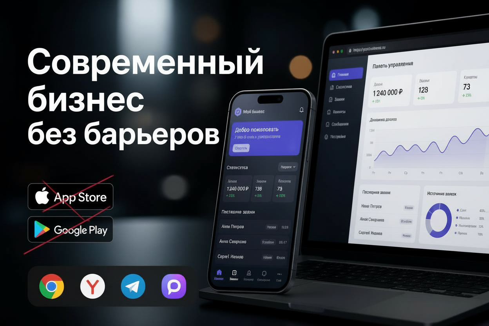

## Устанавливаемое веб-приложение для вашего бизнеса

**Собственное приложение — без лишних барьеров.**

Открывается по обычной ссылке, устанавливается на главный экран смартфона или компьютер и выглядит как привычное приложение. Не нужно искать его в App Store или Google Play — достаточно открыть в совместимом браузере.

**Что входит в базовое решение:**
- Современный, удобный интерфейс для смартфонов и компьютеров.
- Интеграция с сервером для обратной связи, заявок, заказов услуг и других задач.
- Уведомления на e-mail, чтобы не пропускать обращения клиентов.
- Развёртывание на сервере, регистрация и подключение домена при необходимости.

В основе — современные технологии, а не шаблонный сайт. Приложение можно развивать вместе с вашим проектом.

**Это только начало!** Выбирайте подходящую комплектацию: «Базовый», «Эконом» или «Бизнес». Нужны дополнительные возможности? Можно отдельно подключить Telegram/MAX-бота, заказать приложения для Android/iOS и расширить функциональность под ваши задачи.

---

### От покупателя нужно

**Для базового пакета** достаточно краткого и понятного ТЗ: что должно делать приложение, для кого оно предназначено и какие задачи решает. Желательно приложить материалы, если они есть: логотип, фирменные цвета, тексты, иконки, дизайн-концепцию или примеры понравившихся решений.

Для интеграций могут понадобиться доступы к существующим сервисам и ресурсам проекта.

**Выбираете расширенный пакет?** Необязательно готовить всё самостоятельно. Помогу продумать структуру, визуальную концепцию и необходимые материалы — достаточно описать идею проекта и желаемый результат.

---

### Частые вопросы

**1. Чем PWA отличается от обычного сайта?**
Его можно установить на главный экран смартфона или компьютер и запускать как привычное приложение.

**2. Нужно ли скачивать приложение из магазина?**
Нет. Установка доступна прямо из совместимого браузера, без поиска в App Store или Google Play.

**3. Можно ли принимать заявки и заказы?**
Да! Базовая интеграция с сервером позволяет организовать обратную связь, приём заявок и уведомления на e-mail.

**4. Можно ли добавить функции позже?**
Конечно! Ботов, интеграции и другие возможности можно подключать отдельно по мере развития проекта.

**5. Что делать, если нет готового ТЗ или дизайна?**
Всё зависит от пакета. В расширенных комплектациях помогу продумать структуру, визуальную концепцию и необходимые материалы.